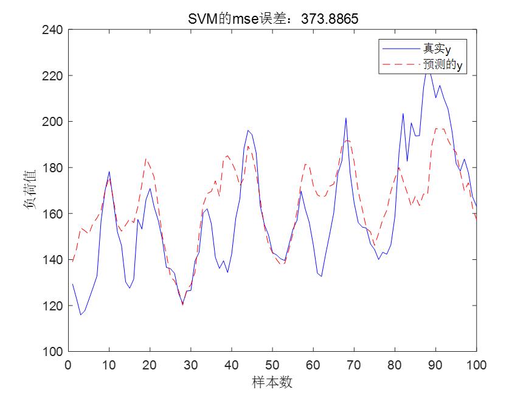
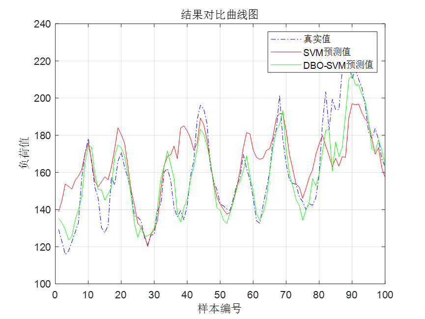
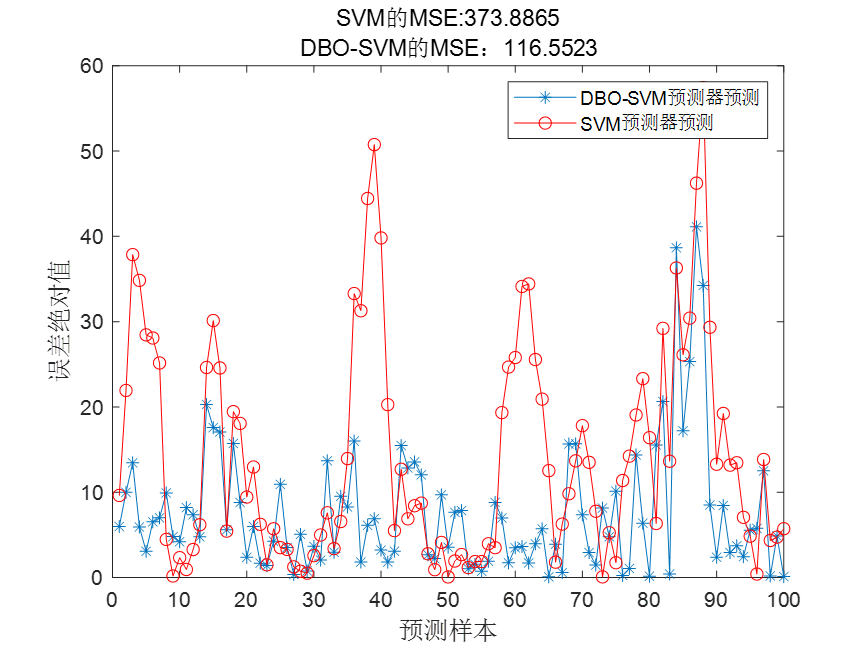
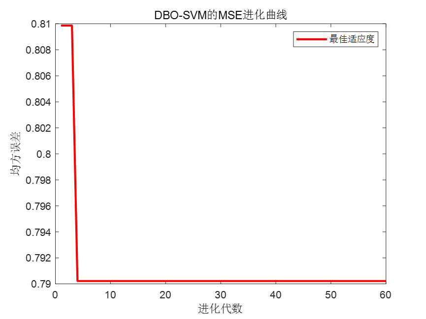
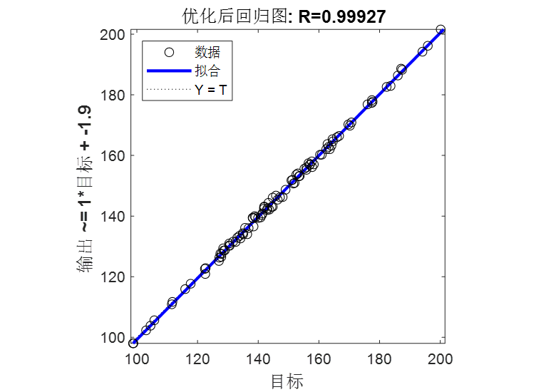
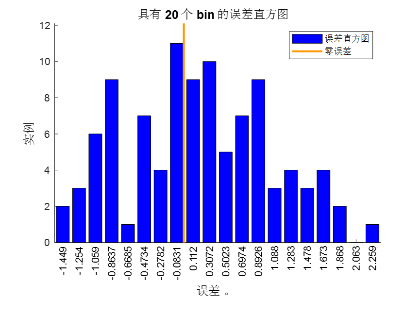
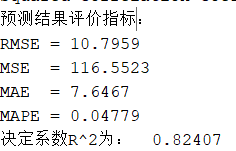

# Optimizing SVM for Power Load Forecasting with DBO, including MATLAB code

Detailed Explanation of Principles
The article optimizes two parameters of Support Vector Machine (SVM), namely, penalty coefficient c and gamma.
Among them, The penalty coefficient c represents the tolerance for errors. The higher the c, It is crucial to tolerate errors less and less. Easy overfitting. The smaller c is, Easy underfitting. C is too large or too small. Generalization ability will deteriorate.
Gamma is a parameter inherently determined by the RBF function when it is selected as the kernel. It indirectly determines the distribution of data after being mapped to a new feature space. The larger the gamma value, the fewer support vectors; conversely, the smaller the gamma value, the more support vectors. The number of support vectors affects both the speed of training and prediction.
Optimize SVM with Dung Beetle, parameter settings ranges are:
Penalty coefficient c[0.001, 1000] gamma[2^-8,2^8]
Set the DBO population size to 30 and the number of iterations to 60.
Data Preparation
Processing of power load data
The data set includes load values, temperature, humidity, wind speed, pressure, precipitation, visibility, vapor pressure, and perceived temperature. Some screenshots of the data are as follows:
1200 samples are selected as the training set, each sample composed of all data from that day's 24 hours. Therefore, the input size of the training set is 1200*216, where 216=24*9, 24 represents 24 hours and 9 denotes 9 features. The output size of the training set is: 1200*1, where 1 represents the load value for the next hour.
Select 100 samples as the test set, similarly, the input data size of the test set is 100*216, and the output data size of the training set is: 100*1.
Results display
SVM is used for training and prediction of power load data.
The SVM prediction results are as follows:
\n        \n  
It can be observed that the prediction effect of unoptimized SVM is not very good.
The prediction effect of DBO-SVM model is as follows:
\n        \n  
The error comparison chart is as follows:
\n        \n  
DBO-SVM Evolution Curve:
\n        \n  
The DBO-SVM prediction results have significantly improved, with the MSE error of DBO-SVM being 0.79022, which is a significant improvement compared to the unoptimized SVM's 17.2023!
The regression fitting plot of DBO-SVM:
Error histogram:
\n        \n  
Code segment
%% Initialize DBO parameters\npop=30;   % Initial population size\nmaxgen=60;   %Maximum number of evolutionary generations\nlb = [10^-3, 2^-8];\nub = [10^3, 2^8];\ndim = 2;\n[fMin,bestX,Convergence_curve ] = DBOforSVM(pop, maxgen,lb,ub,dim,inputn,output_train,inputn_test,output_test);\nbestc=bestX(1);\nbestg=bestX(2);\ndisp(['The optimal parameters are...: ',num2str(bestX)])\ncmd = [' -t 2',' -c ',num2str(bestc),' -g ',num2str(bestg),' -s 3 -h 0 -q'];\nmode1= libsvmtrain(output_train,inputn,cmd);\n[test_simu1,~,~]= libsvmpredict(output_test,inputn_test,mode1);\nmse1=mse(output_test,test_simu1); \nerror1 = output_test - test_simu1;\n\n%% Draw evolutionary curve\nfigure\nplot(Convergence_curve,'r-','linewidth',2)\nxlabel('Evolutionary epoch')\nylabel('Mean Squared Error')\nlegend('Best adaptation')\ntitle('DBO-SVMOutput the English term only:MSEEvolutionary curve')\n% Draw error comparison graph\nfigure\nplot(abs(error1),'-*')\nhold on\nplot(abs(error0),'-or')\ntitle(['SVMOutput the English term only:MSE:',num2str(mse0),newline,'DBO-SVMOutput the English term only:MSE: ',num2str(mse1)])\nxlabel('Predictive sample','fontsize',12)\nylabel('Absolute error','fontsize',12)\nlegend('DBO-SVMPredictor prediction','SVMPredictor prediction')\n% Draw the result comparison curve graph\nfigure\nplot(output_test,'b-.')\nhold on\nplot(test_simu0,'r')\nhold on\nplot(test_simu1,'g')\nhold off\ngrid on\ntitle(['Result comparison curve'])\nlegend('True value','SVMPredicted value','DBO-SVMPredicted value')\nxlabel('Sample number')\nylabel('Load value')\n\n%% Regression plot and error histogram\nfigure;\nplotregression(test_simu1,output_test,['Optimized regression plot']);\nset(gcf,'color','w')\n\nfigure;\nploterrhist(test_simu1-output_test,['Error histogram']);\nset(gcf,'color','w')\n\n%% Print out the evaluation indicators\n% Prediction Result Evaluation\nae= abs(test_simu1-output_test);\nrmse = (mean(ae.^2)).^0.5;\nmse = mean(ae.^2);\nmae = mean(ae);\nmape = mean(ae./test_simu1);\n[R,r] = corr(output_test,test_simu1);\nR2 = 1 - norm(output_test -  test_simu1)^2 / norm(output_test-mean(output_test ))^2;\ndisp('Prediction results evaluation indicators: ')\ndisp(['RMSE = ', num2str(rmse)])\ndisp(['MSE  = ', num2str(mse)])\ndisp(['MAE  = ', num2str(mae)])\ndisp(['MAPE = ', num2str(mape)])\ndisp(['R-squaredR^2For:   ',num2str(R2)])\n  

## Images

<!-- PAYMENT_BLOCK -->

## Get this dataset

- Payment link (Stripe): [Buy now](https://buy.stripe.com/3cs8yP7sY87d0vu9AB)
- Payment QR code: 

<!-- /PAYMENT_BLOCK -->
